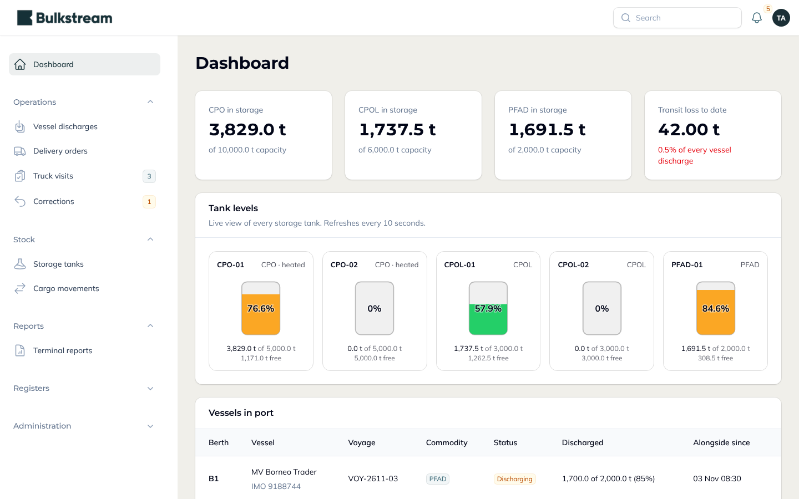
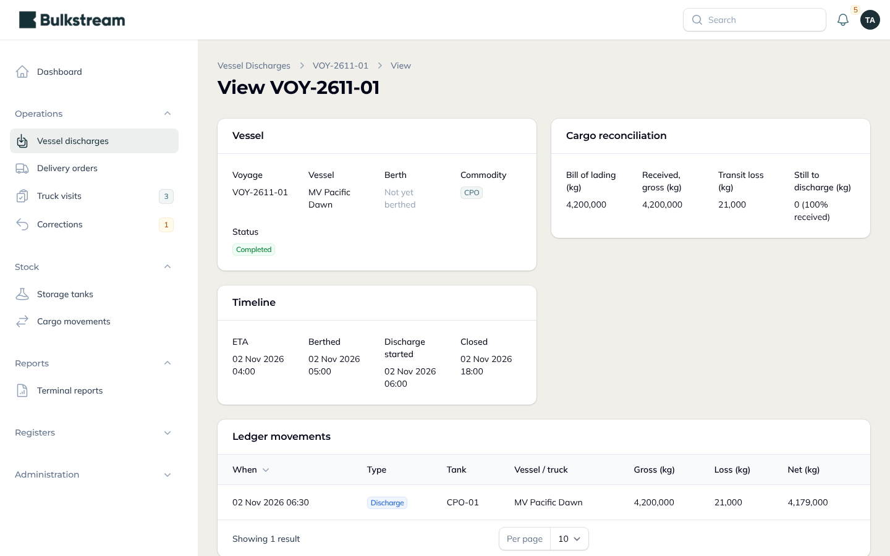
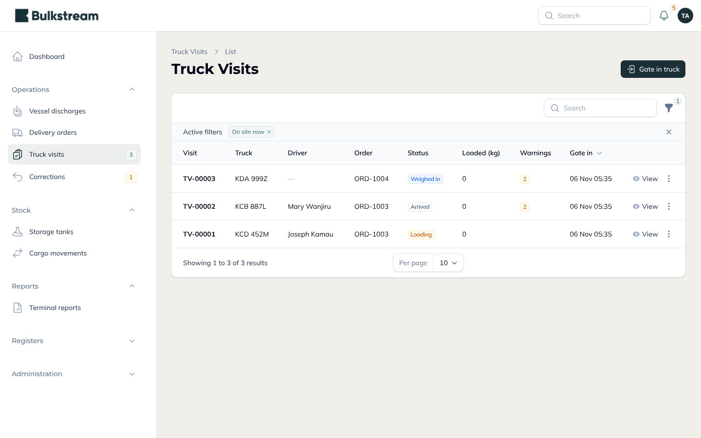
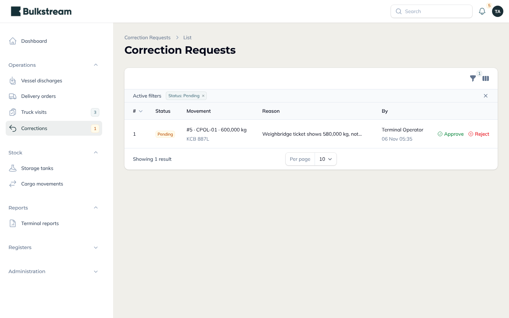
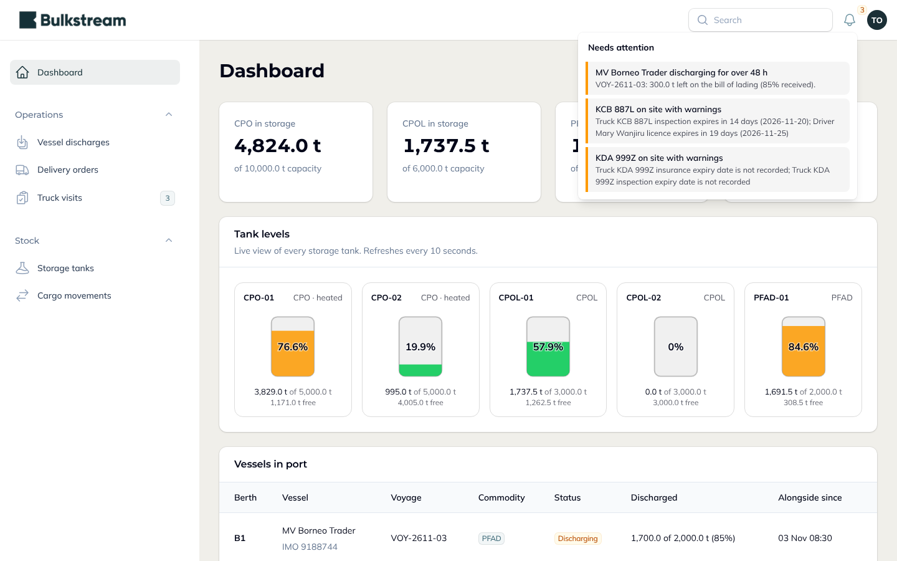
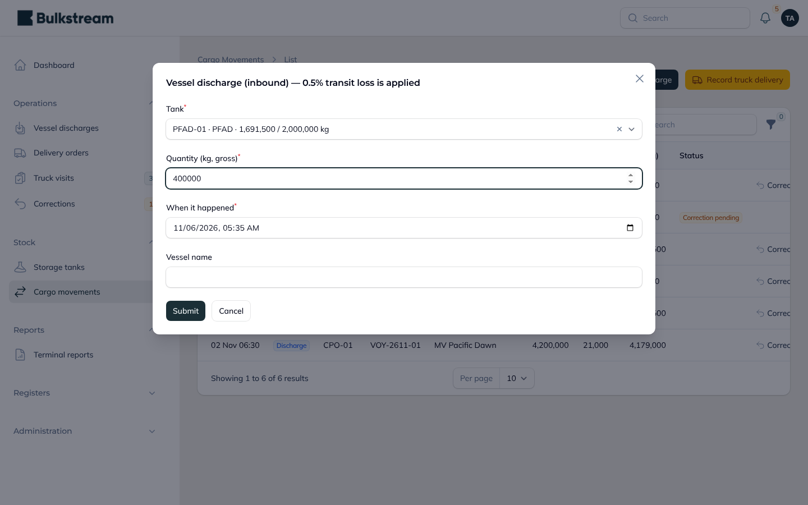
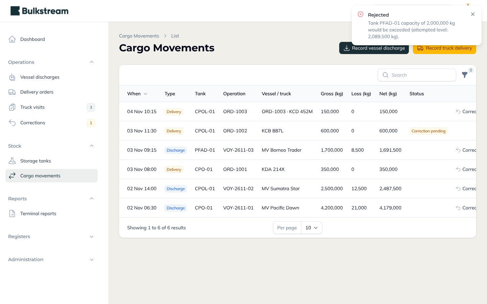
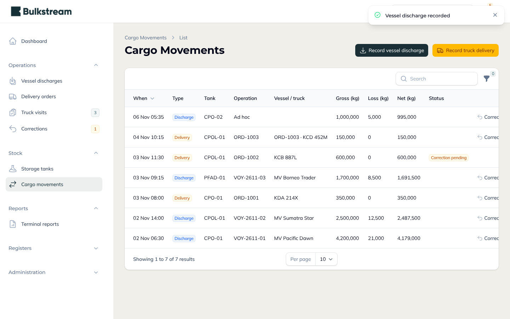
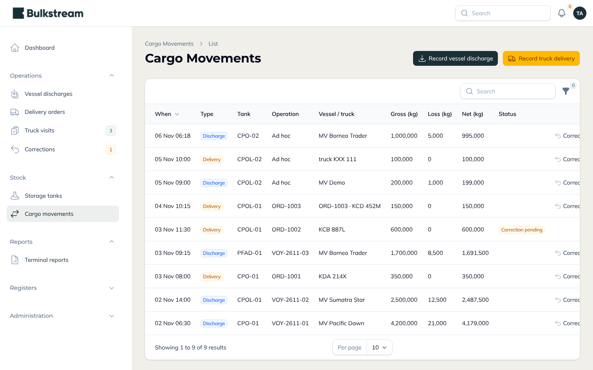

<p align="center">
  <picture>
    <source media="(prefers-color-scheme: dark)" srcset="public/images/bulkstream-logo-white.png">
    
  </picture>
</p>

<h1 align="center">Cargo Handling System</h1>
<p align="center"><b>Bulkstream Limited System Developer Technical Assessment</b></p>

## 1. Overview

A control system for a bulk liquid port terminal. It follows palm oil along the workflow in the brief: **vessel discharge (inbound) → shore storage tanks → truck delivery (outbound)**, for Crude Palm Oil (CPO), Crude Palm Olein (CPOL) and Palm Fatty Acid Distillate (PFAD).

- **Built with:** Laravel 13 and FilamentPHP 5
- **Repository:** https://github.com/khalilaj/Cargo-Handling-
- **Live demo:** https://cargo-handling-owno.onrender.com/admin (Render free hosting, database on Supabase)

| Role | What they can do |
| --- | --- |
| **Admin** | Everything, including users and roles |
| **Supervisor** | Manages operations and registers, approves or rejects corrections |
| **Operator** | Runs daily operations and requests corrections |
| **Auditor** | Read-only view of everything, including the audit log |

Every movement of oil is one permanent row in a ledger (gross, loss and net kilograms, and the time it really happened). A tank's level is always worked out from that ledger in time order, which is what makes late data, corrections and audits safe.

## 2. How the system meets the brief

| Requirement | How it is met |
| --- | --- |
| **Capacity boundaries** | A tank can never go over its limit. Trying to overflow it raises a custom domain exception (`TankCapacityExceededException`) and nothing is saved. |
| **0.5% volumetric loss** | Every inbound vessel flow loses 0.5%. Gross, loss and net are stored on each movement and only the net goes into the tank. Truck deliveries have no loss. |
| **Time-series synchronisation** | Records that arrive late or out of order are sorted by timestamp, and balances are rebuilt from the ledger in time order before anything is changed. |
| **Atomic operations** | Each movement runs in one database transaction with a lock on the tank, so two requests at the same moment cannot take the same space. Repeated messages are applied once. |
| **Laravel + FilamentPHP** | Operational control panel built in Filament, with roles for admin, supervisor, operator and auditor. |
| **Reactive handlers** | Action forms respond without reloading the page. The dashboard, tank levels, vessels and trucks refresh by themselves every few seconds. |
| **Entity state hooks** | Model events keep derived data in step and write the audit trail. Voyages, orders and truck visits move through fixed status steps, so illegal jumps are refused. |
| **Domain separation** | All business rules live in a separate domain layer (`app/Domain`: cargo, operations, fleet, corrections, access, audit, reporting). The screens only call it. |

## 3. The system

**Dashboard.** Live tank levels, stock per product against capacity, total transit loss to date, vessels in port and trucks on site. The bell in the top bar lists what needs attention for the signed-in person.



**Vessel discharges.** Each voyage tracks the bill of lading, what has been received, the loss and what is still to come. A ship can only come alongside a free berth.



**Truck visits.** Trucks go through arrived, weighed in, loading, weighed out and departed. A truck's payload is a hard limit. Expired documents show a warning but do not block loading.



**Corrections.** The ledger is never edited. A mistake is fixed by a reversing entry that an operator requests and a different supervisor approves.



**Roles.** Each role sees only what it needs. An operator has a short menu and a bell with the things to act on; an auditor can look but not change anything.



## 4. The four rules shown working

**Capacity boundary.** PFAD-01 holds 1,691.5 t of 2,000 t. Pumping in another 400 t is refused with the domain exception, and the ledger stays unchanged.




**0.5% loss.** A discharge of 1,000,000 kg into CPO-02 is stored as 995,000 kg, with 5,000 kg recorded as loss.



**Out-of-order records.** Two records are sent together to the ingest interface in the wrong order: first a 100,000 kg truck delivery at 10:00, then the 200,000 kg discharge at 09:00 that filled the tank.

| Order sent | Time of event | Order processed | Result |
| --- | --- | --- | --- |
| 1. Truck delivery 100,000 kg | 10:00 | 2nd | Applied |
| 2. Vessel discharge 200,000 kg | 09:00 | 1st | Applied, 199,000 kg net after 1,000 kg loss |

The tank ends at 99,000 kg. Sending the same batch again changes nothing, and a record that cannot be right (for example delivering from an empty tank) is rejected on its own without stopping the others.



**Atomic operations.** Parallel requests were run against the database at the same time: simultaneous discharges never overfill a tank, the same message sent twice is applied once, two trucks cannot gate in as the same vehicle, two ships cannot take the same berth, and two supervisors cannot approve the same correction twice.

## 5. Beyond the brief

- Registers for vessels, berths, customers, transporters, trucks and drivers, with document expiry tracking.
- Truck visit workflow with weighbridge checks.
- Four roles with access limited by menu, page and action.
- Audit log of who changed what, and reversal-based corrections with a second approver.
- Terminal reports with PDF and CSV export.
- Bulkstream logo, colours and fonts throughout.

## 6. Hosting

The application runs on Render's free hosting and the database is on Supabase. The first page load can take a few seconds while the free service wakes up.

---

## For developers

### Run locally

```bash
composer install
cp .env.example .env && php artisan key:generate
touch database/database.sqlite
php artisan migrate --seed       # demo accounts use ADMIN_PASSWORD from .env
php artisan serve                # http://localhost:8000/admin
php artisan test
```

### Message-pipeline endpoint

```bash
curl -X POST $URL/api/movements/ingest -H "Authorization: Bearer $INGEST_TOKEN" -H 'Content-Type: application/json' -d '{
  "records": [
    {"tank":"CPOL-01","type":"truck_delivery","quantity_kg":30000,"occurred_at":"2026-11-05T10:00:00Z","idempotency_key":"k2"},
    {"tank":"CPOL-01","type":"vessel_discharge","quantity_kg":100000,"occurred_at":"2026-11-05T08:00:00Z","idempotency_key":"k1"}
  ]}'
```

Records may be in any order; each gets `applied` or `rejected` (with a reason). Re-sending a batch changes nothing.

### Tests and CI

`php artisan test` covers the four rules, the status workflows, every screen and every role. The parallel-process concurrency tests (`--filter Concurrency`) need PostgreSQL. GitHub Actions (`.github/workflows/ci.yml`) runs code style, the tests and the concurrency tests on every push.

### Branding

Logo from the assessment brief, ink `#153037` / `#1B2F36`, paper `#F0EFEA`, Montserrat for headings and Mulish for text. Set in `app/Providers/Filament/AdminPanelProvider.php` and `public/css/bulkstream.css`.
